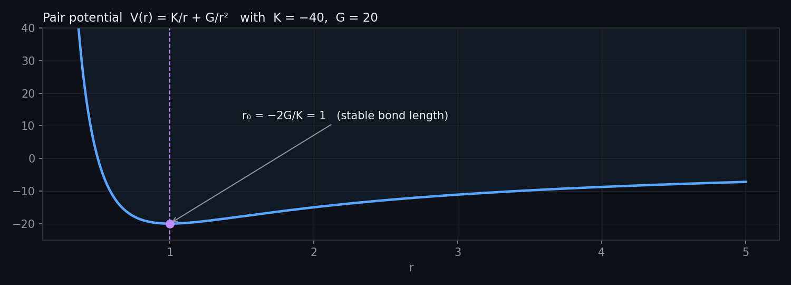
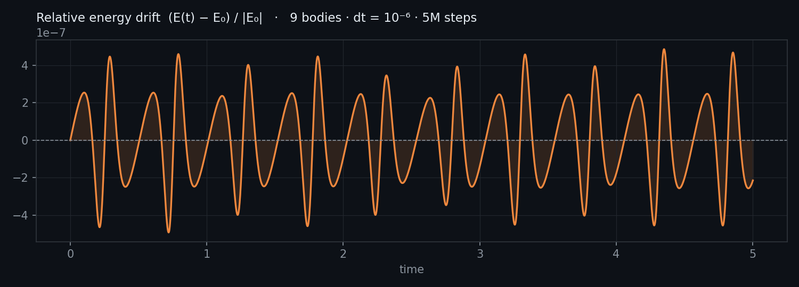

<div align="center">

# 🐰 DustBunny

### A Hamiltonian N‑body particle simulator written in Rust

*Particles that attract, repel and settle into a lattice, with energy conserved to within one part in a million.*

<br>


<br>


<sub>A 3×3 lattice released from rest. Each particle oscillates radially around the centre particle, and the trails fade from magenta (early) to yellow (late).</sub>

</div>

---

## ✨ Highlights

| | |
|---|---|
| ⚛️ **Real Hamiltonian mechanics** | The state is `(q, p)`, not `(x, v)`. Each update applies Hamilton's equations directly. |
| 🎯 **Symplectic integration** | A semi‑implicit Euler step keeps the energy error bounded instead of letting it drift away. |
| 📉 **~5 × 10⁻⁷ relative energy error** | Measured over **5,000,000 steps** of a 9‑body system. See the plot below. |
| 🧲 **Bonded "atoms"** | The pair potential has a stable minimum, so particles form bonds of length `r₀ = 1`. |
| 🦀 **Zero dependencies** | Pure `std` Rust with a cache‑friendly, struct‑of‑arrays layout. |
| 📊 **Plotting included** | Python scripts and a Jupyter notebook for trajectories, animations and energy plots. |

---

## 🧮 The physics

Every particle obeys Hamilton's equations:

$$
\dot q_k = \frac{\partial H}{\partial p_k}, \qquad \dot p_k = -\frac{\partial H}{\partial q_k}
$$

with the N‑body Hamiltonian

$$
H(\mathbf q, \mathbf p) = \sum_i \frac{|\mathbf p_i|^2}{2m_i} + \sum_{i<j} V\big(|\mathbf q_i - \mathbf q_j|\big)
$$

The pair potential combines a long‑range attraction with a short‑range repulsion:

$$
V(r) = \frac{K}{r} + \frac{G}{r^2}, \qquad K = -40,\; G = 20
$$

<div align="center">

</div>

The minimum is at **r₀ = −2G/K = 1**. Particles that start one unit apart therefore sit near equilibrium and oscillate around it, which is why the lattice above "breathes".

### The integrator

`ParticleSystem::update` uses **symplectic (semi‑implicit) Euler**:

```text
q_{n+1} = q_n + dt · ∂H/∂p (p_n)
p_{n+1} = p_n − dt · ∂H/∂q (q_{n+1})   ← uses the *updated* positions
```

The only difference from forward Euler is that the momentum update uses the new positions. That makes the map symplectic, so it preserves phase‑space volume, and the energy error oscillates within a narrow band instead of growing over time:

<div align="center">

</div>

The pairwise forces are computed once per pair and applied to both particles with opposite signs (Newton's third law). That halves the force work, and total momentum is conserved up to floating‑point rounding.

---

## 🚀 Quick start

```bash
# 1. Clone
git clone https://github.com/nobel002/DustBunny.git
cd DustBunny

# 2. Run the simulation (use --release, it is much faster)
cargo run --release
```

This writes two tab‑separated files to the working directory:

| File | Contents |
|---|---|
| `Energy_Latice.csv` | `t`, total `energy` |
| `Q_Latice.csv` | `t`, then `qx1…qxN`, `qy1…qyN` (header also lists `qz`/`p` columns) |

Output is downsampled to one row every 250 steps.

### 📊 Visualise

```bash
pip install numpy pandas matplotlib jupyter
jupyter notebook Vis/Visualisers.ipynb
```

The `Vis/` folder also has standalone scripts for trajectory animations and energy comparisons. They are experimental and may need their CSV paths adjusted.

---

## 🛠️ Make it your own

All the setup is in [`src/main.rs`](src/main.rs). Pass any initial state to `ParticleSystem::from_initial_state`:

```rust
let mut system = ParticleSystem::from_initial_state(
    qx, qy, qz,   // positions
    px, py, pz,   // momenta
    m,            // masses
);

system.update(dt);          // advance one step
let e = system.energy();    // total H(q, p)
let (qx, qy, qz) = system.get_q();
```

| Knob | Where | Default |
|---|---|---|
| Time step `dt` | `main.rs` | `1e-6` |
| Simulated time `T` | `main.rs` | `5.0` |
| Attraction `K` | `ParticleSystem.rs` | `-40.0` |
| Repulsion `G` | `ParticleSystem.rs` | `20.0` |

> 💡 **Tip:** give the particles some initial momentum perpendicular to their bonds and see what happens to the lattice.

---

## 📁 Project layout

```text
DustBunny/
├── src/
│   ├── main.rs             # Scenario setup, time loop, CSV output
│   ├── ParticleSystem.rs   # Hamiltonian, forces, energy, symplectic integrator
│   ├── particle.rs         # (deprecated) per-particle struct
│   └── Physics.md          # Derivation notes
├── Vis/
│   ├── lattice.py          # Animated N-particle trajectories
│   ├── Hamilton_plotter.py # Energy comparison plot
│   ├── PathPlotter.py      # Static 3-body trajectory plot
│   ├── Time_plotter.py     # Animated 3-body trajectories
│   └── Visualisers.ipynb   # Notebook playground
└── docs/                   # README images
```

---

## 🗺️ Roadmap ideas

- [ ] Velocity Verlet / leapfrog (2nd order) and Yoshida (4th order) integrators
- [ ] Command-line arguments for `dt`, `T` and the scenario
- [ ] Parallel force computation with `rayon`
- [ ] Barnes–Hut tree for large N
- [ ] Real-time rendering

---

<div align="center">

Made with 🦀 and Hamiltonians.

</div>
